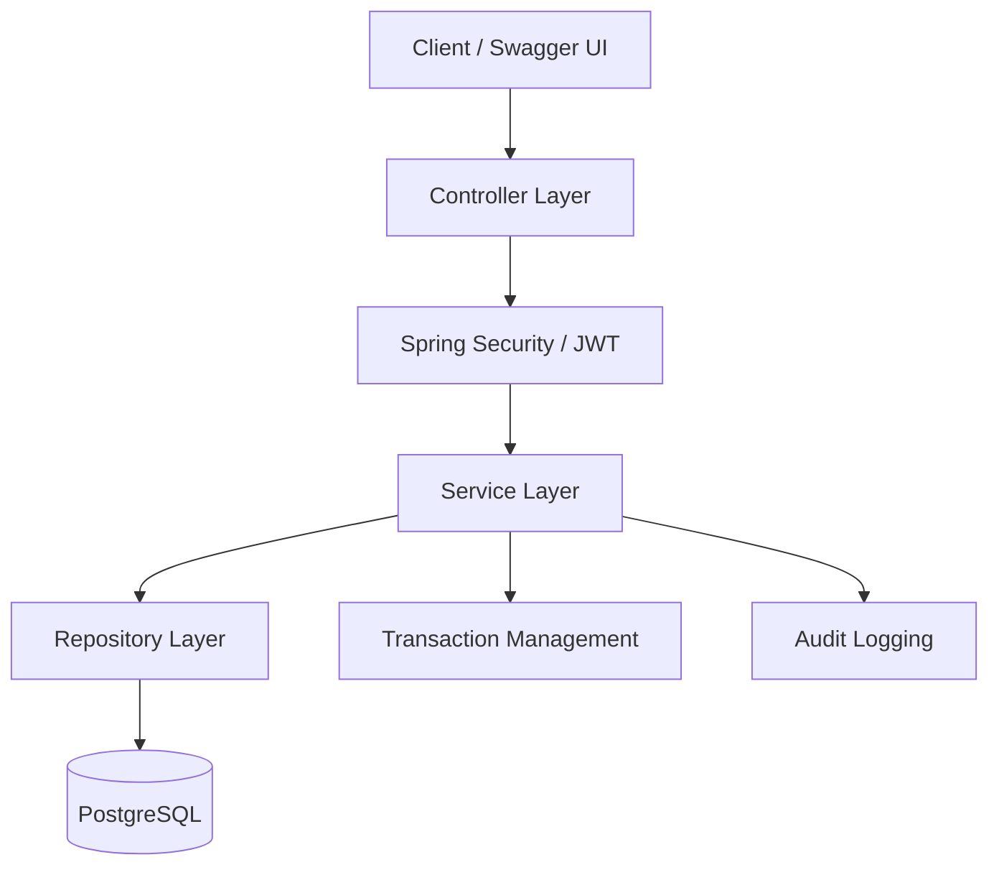

# Payment Wallet System

A RESTful payment wallet backend built using **Java, Spring Boot, PostgreSQL, and Docker**. This project explores secure authentication, wallet operations, money transfers, idempotent payment processing, concurrency handling, and audit logging.

### Links

- **Live API Documentation:** [Swagger UI](https://payment-wallet-system.onrender.com/swagger-ui/index.html)
- **API Base URL:** https://payment-wallet-system.onrender.com
- **Source Code:** [GitHub Repository](https://github.com/SmritiSingh18/Payment-Wallet-System)

> The API base URL is intended for API access. Use Swagger UI to explore and test the endpoints interactively.

## Features

- User registration and authentication
- JWT-based authentication with Spring Security
- Password hashing
- Wallet details and balance management
- Add-money operations
- Transfers between wallets
- Transaction history
- Idempotency support for payment requests
- Database transaction management and concurrency handling
- Audit logging for important events
- Centralized exception handling
- PostgreSQL persistence using Spring Data JPA and Hibernate
- Docker-based local development
- API documentation with Swagger/OpenAPI
- Automated unit and integration testing

## Technology Stack

| Technology | Purpose |
|---|---|
| Java 17 | Programming language |
| Spring Boot | REST API framework |
| Spring Security | Authentication and authorization |
| JWT | Token-based authentication |
| Spring Data JPA | Data access |
| Hibernate | Object-relational mapping |
| PostgreSQL | Relational database |
| Maven | Build and dependency management |
| Docker & Docker Compose | Containerization |
| Swagger/OpenAPI | API documentation |
| JUnit & Mockito | Automated testing |

## Architecture

The application follows a layered architecture.



- **Controller layer:** Exposes REST endpoints.
- **Security layer:** Handles authentication and access control.
- **Service layer:** Implements business logic for authentication, wallets, and payments.
- **Repository layer:** Handles database operations through Spring Data JPA.
- **Database:** Persists users, wallets, transactions, idempotency records, and audit logs.

## API Endpoints

| Method | Endpoint | Purpose |
|---|---|---|
| `POST` | `/api/users` | Register a user |
| `POST` | `/api/auth/login` | Authenticate and obtain a JWT |
| `GET` | `/api/wallet` | Retrieve wallet details |
| `POST` | `/api/wallet/add-money` | Add money to a wallet |
| `POST` | `/api/wallet/transfer` | Transfer money between wallets |
| `GET` | `/api/transactions` | Retrieve transaction history |

See the [Swagger UI](https://payment-wallet-system.onrender.com/swagger-ui/index.html) for request schemas, parameters, and response formats.

Protected endpoints require valid authentication where configured.

## Security and Payment Reliability

The project addresses several important backend engineering concerns:

- **Authentication:** JWT-based authentication with stateless Spring Security configuration.
- **Password storage:** Password hashing rather than plaintext storage.
- **Idempotency:** Handling repeated payment requests safely using idempotency keys.
- **Concurrency:** Testing concurrent wallet operations and protecting balance consistency.
- **Database transactions:** Keeping related database changes consistent.
- **Audit logging:** Recording significant application events.

## Running Locally

### Prerequisites

- Java 17
- Docker Desktop and Docker Compose
- Git

### 1. Clone the repository

```bash
git clone https://github.com/SmritiSingh18/Payment-Wallet-System.git
cd Payment-Wallet-System
```

### 2. Configure environment variables

Create a `.env` file in the project root with your own local development values:

```env
DB_PASSWORD=your_local_database_password
JWT_SECRET=your_base64_encoded_jwt_secret
```

Use a sufficiently strong secret compatible with the application's JWT configuration. Never commit `.env` or real credentials to GitHub.

### 3. Start the application

```bash
docker compose up -d --build
```

### 4. Open the local API documentation

- Application: `http://localhost:8080`
- Swagger UI: `http://localhost:8080/swagger-ui/index.html`
- OpenAPI specification: `http://localhost:8080/v3/api-docs`

### 5. Stop the containers

```bash
docker compose down
```

To also remove the local database volume, run `docker compose down -v`. This deletes the data stored in that Docker volume.

## Running Tests

Run the automated test suite with:

```bash
./mvnw test
```

The latest recorded test run completed with **43 passing tests**. Run the command above to verify the current repository state.

## Deployment

The application is deployed on Render with a PostgreSQL database.

- **Swagger UI:** https://payment-wallet-system.onrender.com/swagger-ui/index.html
- **Hosting:** Render
- **Database:** PostgreSQL

## Future Improvements

- Add continuous integration with GitHub Actions.
- Improve application monitoring and structured logging.
- Expand integration and failure-recovery tests.
- Review production security, database access, and secret rotation.
- Improve operational visibility for payment failures and reconciliation.

## Key Learnings

- Building layered REST APIs with Spring Boot.
- Implementing JWT authentication and password hashing.
- Designing relational data models with PostgreSQL and JPA.
- Handling idempotency and concurrent payment operations.
- Writing automated tests for backend business logic.
- Containerizing and deploying a backend application.

---

**Built with Java, Spring Boot, PostgreSQL, and Docker.**